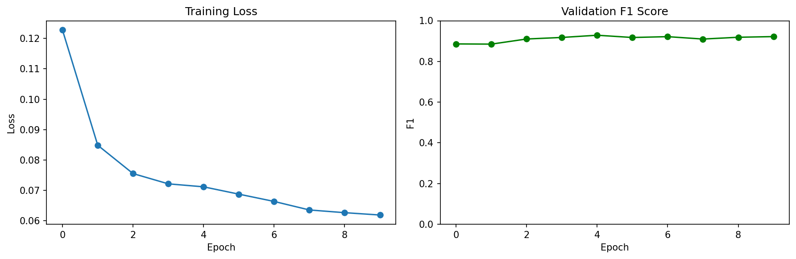
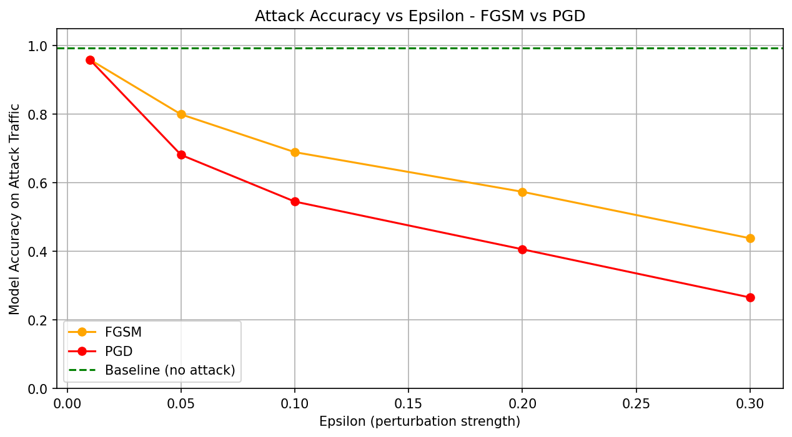
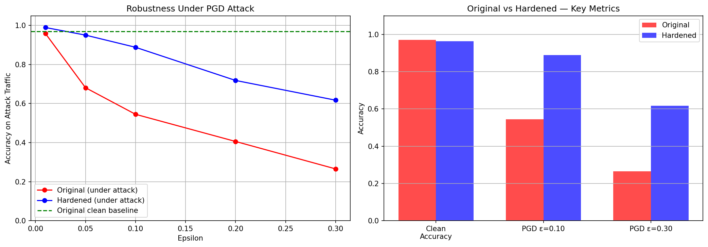

# Adversarial Attack & Defense on ML-Based Network Intrusion Detection

## Developer
Christian de Guzman

## Purpose
Create a machine learning model that detects network instructions (cyberattacks in network traffic). Attack the model itself using adversarial techniques and then fix it <br>
This project is to help improve my understanding of AI/ML. Also, providing an opportunity to grow as a developer by combining my passion for both Computer Science and Cybersecurity.

---

## Results at a Glance

| Model | Clean Accuracy | PGD Attack (ε=0.10) | PGD Attack (ε=0.30) |
|---|---|---|---|
| Original | 96.7% | 40.7% | 22.1% |
| Hardened | 94.1% | 84.0% | 56.4% |

**Key finding:** 
- Created a 97% threat detection model.
- PGD adversarial training recovers 43 percentage points of robustness at ε=0.10 with only a 2.6% clean accuracy cost.

---

## Objectives
### Threat Detection
Train a neural network on real-world labeled network traffic (CICIDS-2017 dataset) to classify traffic as benign or malicious (96.7% accuracy, Attack Recall = 1.00).

### Adversarial Attacks
Simulate a real attacker using FGSM and PGD attacks to craft malicious network traffic that the model misclassifies as safe. PGD reduces detection accuracy from 99.8% → 22.1% at ε=0.30.

### Adversarial Defense
Retrain the model using adversarial training (feeding it attack examples during training). Hardened model recovers to 56.4% under the same PGD attack with only a 2.6% drop in clean accuracy.

---

## Model Architecture

```
Network Flow Features (78)
         │
    [Linear 256] → BatchNorm → ReLU → Dropout(0.3)
         │
    [Linear 128] → BatchNorm → ReLU → Dropout(0.3)
         │
    [Linear  64] → BatchNorm → ReLU → Dropout(0.3)
         │
    [Linear   2] → Benign (0) / Attack (1)
```

---

## Attack Methods

**FGSM (Fast Gradient Sign Method)** — Single-step white-box attack that changes the input to try to trick/fool the model. Limited effectiveness because of BatchNorm robustness (99.8% → 94.6%).

**PGD (Projected Gradient Descent)** — Iterative attack (40 steps, α=0.01) using a margin loss to directly push the benign logit above the attack logit. Far more effective reducicng the accuracy from 99.8% → 22.1% at ε=0.30.

---

## Defense Method

**Adversarial Training via Fine-tuning:**
- Initialize from pre-trained weights (preserves clean accuracy)
- Replace 30% of each training batch with PGD adversarial examples generated on the fly
- Lower learning rate (1e-4) to avoid overwriting learned features
- Result: 84.0% detection accuracy under PGD ε=0.10 vs 40.7% for the original

---

## Project Structure
```
notebooks/
    ├── threat_detection.ipynb
    ├── defenses.ipynb
    └── adversarial_attacks.ipynb
results/
    ├── training_curves.png
    ├── Final_Eval.png
    ├── attack_comparison.png
    ├── defense_comparison.png
    └── results.md
.gitignore
README.md
requirements.txt
```
---

## Visualizations

### Training — Loss & F1

- Loss decreases steadily each epoch
- As the epoch increases, F1 score is stable and high (~0.93)

### Adversarial Attack — FGSM vs PGD

- PGD is significantly more effective than FGSM
- Model collapses to 22.1% accuracy under strong PGD

### Defense — Original vs Hardened

- Hardened model maintains much higher accuracy under attack
- Small clean accuracy tradeoff (96.7% → 94.1%)

---

## Setup
### Dataset
**CICIDS-2017** (Canadian Institute for Cybersecurity)
- ~2.8M network flow records, 78 features per flow
- Labels: BENIGN, DDoS, PortScan, Bot, Web Attack, DoS, and more
- Binary classification: BENIGN (0) vs. any attack (1)

Download: https://www.unb.ca/cic/datasets/ids-2017.html → MachineLearningCSV.zip → place in `data/MachineLearningCVE/`

```bash
git clone https://github.com/ccdeguzman/Adversarial-Attack-Defense-on-ML-Based-Network-Intrusion-Detection.git
cd Adversarial-Attack-Defense-on-ML-Based-Network-Intrusion-Detection

python -m venv venv
venv\Scripts\activate        # Windows
    OR
source venv/bin/activate     # Mac/Linux

pip install -r requirements.txt
```

Run notebooks in order: `threat_detection` → `adversarial_attacks` → `defenses`

---

## Tech Stack

PyTorch · scikit-learn · pandas · NumPy · CICIDS-2017

---

## What I learned
- I learned how to run jupyter notebook from Visual Studio Code terminal. I usually run jupyter notebook on Google Drive.
- I learned that I had to only take 30% of each file which is still hundreds of thousands of rows. The full dataset is too big for my current RAM. 
- I learned that F1 score is better for imbalanced classes because it balances both recall and precision. False positives and false negatives affect the score. <br>
F1 uses a harmonic mean, the F1 score is only high if both precision and recall are high. 
- Running FGSM with different epsilon values, the model held up well even with the strongest epsilon. Apparently this is a known phenomenon because FGSM works best on image models that are very sensitive to small changes. The model uses Batch Normalization which helps stablize the data as it moves through the network, making it harder for a single-step attack. So naturally, this makes the model more robust.
- Training from scratch with 50% adversarial example was too aggressive and the harderned model forgot to detect clean attacks. The fix was to fine-tune the original model instead of starting from scratch since it knows how to classify already.

---

## Resources and Works Cited
- Iman Sharafaldin, Arash Habibi Lashkari, and Ali A. Ghorbani, “Toward Generating a New Intrusion Detection Dataset and Intrusion Traffic Characterization”, 4th International Conference on Information Systems Security and Privacy (ICISSP), Portugal, January 2018.
- Adversarial Robustness Tutorial: FGSM vs PGD Attacks in PyTorch (Hands-on Code): https://www.youtube.com/watch?v=uX7IkTlyfuc
- Adversarial Robustness Toolbox How to attack and defend your machine learning models: https://www.youtube.com/watch?v=tTN_BqTv440
