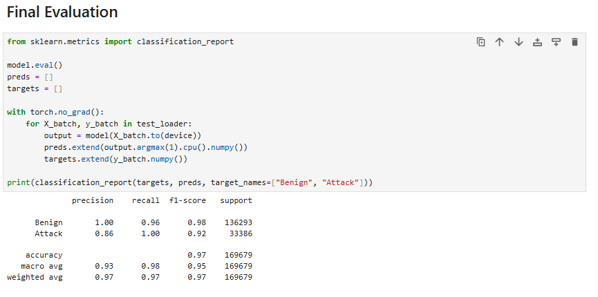

# Adversarial Attack & Defense on ML-Based Network Intrusion Detection

## Developer
Christian de Guzman

## Purpose
Create a machine learning model that detects network instructions (cyberattacks in network traffic). Attack the model itself using adversarial techniques and then fix it <br>
This project is to help improve my understanding of AI/ML. Also, providing an opportunity to grow as a developer by combining my passion for both Computer Science and Cybersecurity.

## Objectives
### Threat Detection
Create a Threat Detector by training a neural network on real-world labeled network traffic (CCIDS2017 dataset) to classify traffic as benign or malicious. <br>
### Adversarial Attacks
Simulate a real attacker (Adversarial Attacker) by using FGSM(Fast Gradient Sign Method) and PGD(Projected Gradient Descent) attacks to craft malicious network traffic that the model missclassifies as safe. <br>
Retrain the model using adversarial training (feeding it attack examples during training) and apply input preprocessing defenses. 

## Project Sturcture
```
notebooks/
    ├── threat_detection.ipynb
    └── 
results/
    ├── training_curves.png
    ├── Final_Eval.png
    └── results.md
.gitignore
README.md
requirements.txt
```
## Results
### Plot Results
 <br>
1. As the epoch increases, the Training Loss decreases.
2. As the epoch increases, the F1 is stable and high

### Final Evaluation
 <br>
Precision - of everything the model flagged as X, how many actually were X <br>
Recall - of actual X cases, how many did the model catch <br>
The Recall for Attack is 1.00 meaning that the model misses zero attacks. <br>
The Precision for Attack is 0.86 meaning that ~14% of benign traffic gets flagged as an attack(false positives). <br>

### Threat Detection Result
Created a 97% accurate threat detection model.

## What I learned
- I learned how to run jupyter notebook from Visual Studio Code terminal. I usually run jupyter notebook on Google Drive.
- I learned that I had to only take 30% of each file which is still hundreds of thousands of rows. The full dataset is too big for my current RAM. 
- I learned that F1 score is better for imbalanced classes because it balances both recall and precision. False positives and false negatives affect the score. <br>
F1 uses a harmonic mean, the F1 score is only high if both precision and recall are high. 
- Running FGSM with different epsilon values, the model held up well against FGSM even with the strongest epsilon. Apparently this is a known phenomenon because FGSM works best on image models that are very sensitive to small changes. The model uses Batch Normalization which helps stablize the data as it moves through the network, making it harder for a single-step attack. So naturally, this makes the model more robust.

## Resources and Works Cited
- Iman Sharafaldin, Arash Habibi Lashkari, and Ali A. Ghorbani, “Toward Generating a New Intrusion Detection Dataset and Intrusion Traffic Characterization”, 4th International Conference on Information Systems Security and Privacy (ICISSP), Portugal, January 2018.
- Adversarial Robustness Tutorial: FGSM vs PGD Attacks in PyTorch (Hands-on Code): https://www.youtube.com/watch?v=uX7IkTlyfuc
- Adversarial Robustness Toolbox How to attack and defend your machine learning models: https://www.youtube.com/watch?v=tTN_BqTv440
